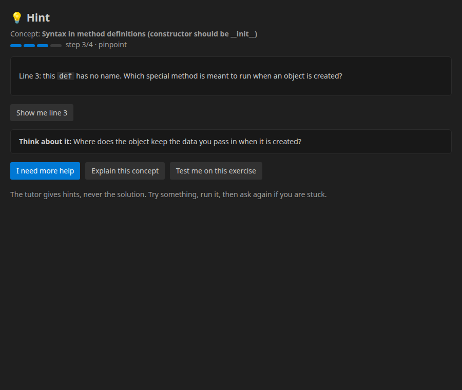
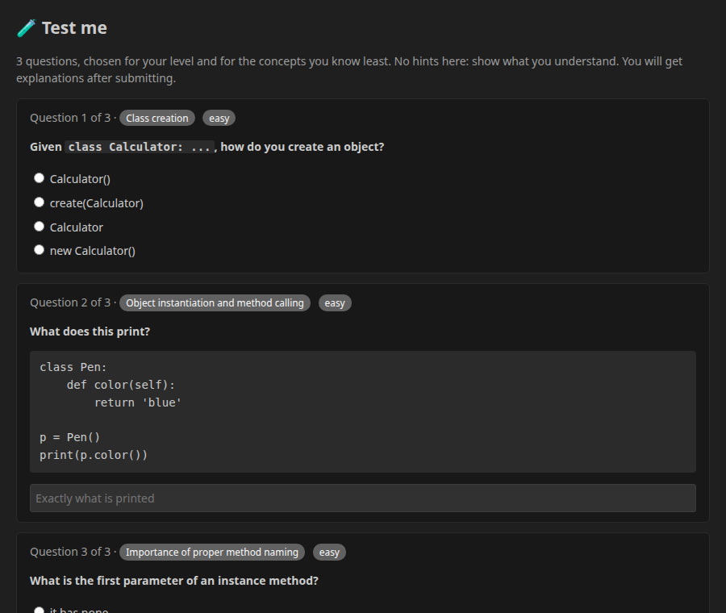
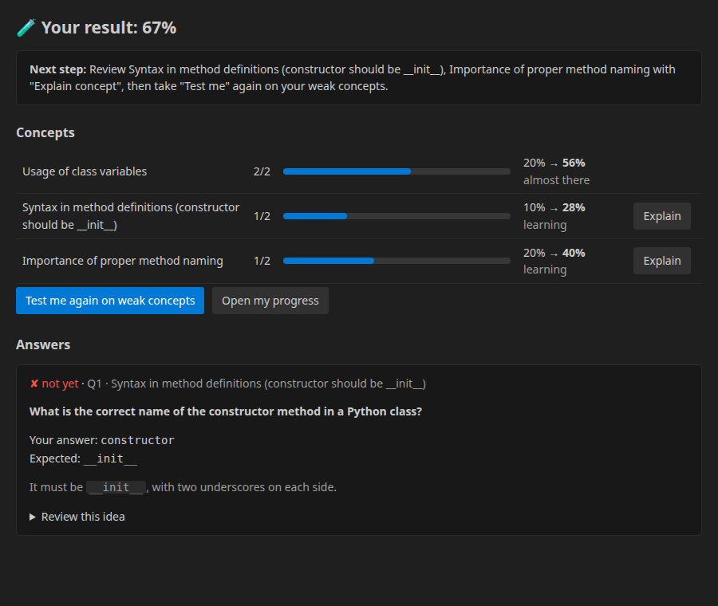
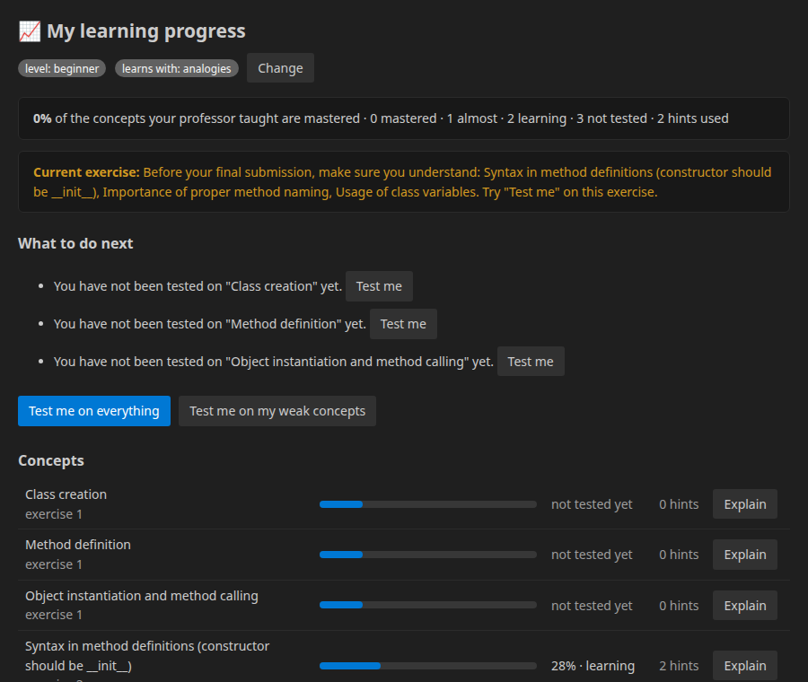

# Code-Hinter

**An AI tutor inside VS Code that follows each student and gives hints instead of solutions.**

Code-Hinter is part of our ECL project linking professors and students. The professor writes an
exercise and lists the concepts it should teach. The student works on it in VS Code, and the tutor:

- **only gives hints**, never the solution. The hints get stronger step by step, and once they run
  out the student is sent to the professor;
- **adapts to the student**: their level (beginner / intermediate / advanced) and the way they
  understand best (examples, analogies, step by step, or guiding questions);
- **follows the student**: it estimates how well they know each concept from quizzes,
  evaluations and the hints they ask for, and corrects their level from that evidence;
- **tests them (`Test me`)** on *every* concept the professor taught, at the right difficulty,
  then explains each mistake in the student's own learning style;
- **keeps the professor in the loop**: class-level insights, struggling students, and
  "Ask my professor" requests that come with the student's code.

It replaces the teacher for the routine 80% (being there at 11 pm, re-explaining, checking
understanding) but not 100%. The tutor is built to know when to hand the student back to the professor.

> Demos: [extension](https://youtu.be/IU4lvCVFDRM) · [app](https://youtu.be/8QEqd-eQrrI)

<table>
<tr>
<td width="50%"><br><sub><b>Hint ladder.</b> Step 3/4 points at the line and the concept, never the corrected code.</sub></td>
<td width="50%"><br><sub><b>Test me.</b> One question per concept or more, difficulty matched to the student, easy first.</sub></td>
</tr>
<tr>
<td><br><sub><b>Results.</b> Mastery before → after per concept, explanations, a re-teach in the student's style.</sub></td>
<td><br><sub><b>Progress.</b> Every concept the professor taught, what to do next, readiness before the final submission.</sub></td>
</tr>
</table>

## What the student can do

All commands are in the Command Palette under **Code Hinter**. The most useful ones are also in
the editor's right-click menu, the editor title bar, and the status bar (`💡 Hint`).

| Command | Shortcut | What it does |
|---|---|---|
| `Give me a hint` | `Ctrl+Alt+H` | Next step of the hint ladder for the current file: **nudge → concept → pinpoint → plan**, then "Ask my professor". |
| `Ask the tutor a question` | `Ctrl+Alt+Q` | Free-form question ("why does my loop stop early?"). The answer is a hint, not code. |
| `Explain a concept` | | Explains any concept of the exercise in the student's style and level, on an example unrelated to the exercise. |
| `Test me` | `Ctrl+Alt+T` | Adaptive quiz on **this exercise**, **everything my professor taught**, or **my weak concepts**. |
| `My learning progress` | | Mastery of every concept, recommendations, quiz history, professor replies. |
| `Set up my learning profile` | | Level + learning style (asked automatically at the first login). |
| `Ask my professor` | | Sends the professor a message with the student's code and how many hints they already used. |
| `Evaluate Code` | | Checks the code against the professor's concepts (✔ / ✘ per concept) and feeds the learner model. |
| `submit Code for comparison` | | Final submission. The tutor first checks the student has shown they understand every concept, and offers `Test me` if not. |
| `Login` / `Logout` / `change exercise` / `Test api's` | | Session management and backend health check. |

> The old "replace the whole file with AI code" completion was removed: it gave students the
> solution, which goes against what this tool is for.

## How the tutor works

```
                VS Code extension (TypeScript)                      Flask backend (Python)
 ┌───────────────────────────────────────────────┐     ┌──────────────────────────────────────────────┐
 │ 💡 hint · ❓ ask · 📘 explain · 🧪 Test me      │ ──▶ │ tutor/teaching.py   hint ladder + explanations│
 │ 📈 progress · 🙋 ask my professor · submit     │     │ tutor/code_analysis static checks: line+concept│
 │ editor diagnostics are sent with every hint   │     │ tutor/guardrails    no solution can get out    │
 └───────────────────────────────────────────────┘     │ tutor/quiz.py       adaptive Test me + grading │
                                                       │ tutor/learner.py    per-concept mastery model  │
                                                       │ tutor/knowledge.py  curated teaching content   │
                                                       │ llm/                SmolLM (optional)          │
                                                       └──────────────────────────────────────────────┘
```

- **Hint ladder.** 1 *nudge*: a guiding question. 2 *concept*: the idea again in the student's style.
  3 *pinpoint*: the line to look at and what to look for. 4 *plan*: plain-language steps.
  After that the tutor suggests the professor. Asking again within 20 minutes climbs the ladder;
  a different problem starts again at step 1.
- **Never the solution.** Static analysis finds *where* the problem is and *which concept* it
  belongs to (e.g. `if b = 0:` → comparison vs assignment, `def (self, …)` → constructor). Every
  LLM-written hint goes through guardrails: no code blocks, no code expression the student has not
  written themselves, nothing that matches the professor's reference code, and a length limit.
- **Correct teaching first.** Concepts are taught from a curated knowledge bank (16 topics ×
  3 levels × 4 learning styles, 60+ quiz questions). The LLM handles only what rules can't:
  free-form questions, bugs the static checks don't see, and concepts outside the bank.
  Testing with a real small model showed why: it explained class variables backwards.
- **Learner model.** Each concept has a mastery in [0, 1]. Quiz answers move it the most (harder
  questions move it more), professor-criteria evaluations move it less, and hint requests lower it
  slightly. With enough evidence, the student's *effective* level replaces the level they declared.

The full design is in [docs/how-the-tutor-works.md](docs/how-the-tutor-works.md).

### Does it really follow the student?

`examples/06_simulated_students.py` gives 60 simulated students a hidden level of knowledge per
concept. After each takes four `Test me` quizzes (course scope, 6 concepts), we compare the
tutor's estimates with the hidden truth:

| Metric (60 students × 6 concepts, 4 quizzes each) | Value |
|---|---|
| Pearson r, estimated mastery vs. true knowledge | **0.86** |
| "Knows it / doesn't" agreement (threshold 0.5) | **82.5 %** |
| Effective level matches the true level | **86.7 %** |

## Setup

### Backend

```sh
git clone https://github.com/benisalla/code-hinter-vs-code-extension.git
cd code-hinter-vs-code-extension/backend
python3 -m venv venv && source venv/bin/activate
pip install --upgrade pip
pip install -r requirements.txt

# full version with the LLM (SmolLM2-1.7B-Instruct, downloaded on first run)
python main.py --port 5000
# or: rule-based tutor only, no torch/LLM needed (fast, works on any laptop)
python main.py --port 5000 --offline
```

| Environment variable | Default | Meaning |
|---|---|---|
| `CH_LLM_BACKEND` | `smol` | `smol` = local Hugging Face model, `offline` = rule-based tutor only |
| `CH_MODEL` | `HuggingFaceTB/SmolLM2-1.7B-Instruct` | any chat model on the Hub, e.g. `Qwen/Qwen2.5-0.5B-Instruct` |
| `CH_TORCH_DTYPE` | `float32` | `bfloat16` halves memory on CPU |
| `CH_DATA_DIR` | `data/` | where the JSON "tables" live |

Check it:

```sh
curl http://127.0.0.1:5000/api/tutor/status
curl -X POST http://127.0.0.1:5000/api/tutor/hint -H "Content-Type: application/json" \
     -d '{"email": "benalla@example.com", "exercise_id": 2, "code": "class Animal:\n    def (self): pass"}'
```

### Extension

```sh
cd extension
npm install
npm run compile          # then F5 in VS Code to launch the Extension Development Host
```

Set **Settings → Code Hinter → Server Url** (`codeHinter.serverUrl`) to your backend, e.g.
`http://127.0.0.1:5000/api`. Then run `Code Hinter: Login`.

## API

The tutor endpoints are under `/api/tutor` (the existing `/api/evaluate_code`, `/api/compare_code`,
`/api/signin`, … are unchanged):

| Method & path | Body / query | Returns |
|---|---|---|
| `GET /status` | | LLM backend, levels, learning styles |
| `GET /profile` · `PUT /profile` | `email` · `{email, level?, style?, goal?}` | learner profile incl. `effective_level` |
| `POST /hint` | `{email, exercise_id, code, question?, diagnostics?, more?, level?}` | `{hint, level, max_level, concept, line, check_question, escalate, source}` |
| `POST /explain` | `{email, concept, exercise_id?}` | explanation in the student's style |
| `GET /concepts` | `email, exercise_id?` | concepts with mastery and status |
| `POST /quiz` | `{email, scope: exercise\|course\|weak, exercise_id?, n_questions?}` | quiz **without answers** |
| `POST /quiz/<id>/submit` | `{email, answers: {qid: answer}}` | score, per-question feedback, mastery before → after, next step |
| `GET /progress` · `GET /readiness` | `email, exercise_id?` | dashboard data · ready to submit? |
| `POST /help_request` · `GET /help_requests` | `{email, exercise_id, message, code}` · `email` | "Ask my professor" |
| `GET /class/<prof_id>` · `PUT /help_request/<id>` | · `{reply, status?}` | class insights for the professor · reply |

## Examples

Runnable scripts with no server and no LLM. Each one works on a temporary copy of `data/`.

| Script | Shows |
|---|---|
| [`01_learner_profile.py`](backend/examples/01_learner_profile.py) | onboarding: level and learning style |
| [`02_hint_ladder.py`](backend/examples/02_hint_ladder.py) | the 4-step ladder on `if b = 0:`, in two styles, up to "ask your professor" |
| [`03_explain_concept.py`](backend/examples/03_explain_concept.py) | one concept explained four ways, and at advanced level |
| [`04_test_me.py`](backend/examples/04_test_me.py) | a quiz, its grading, mastery changes and re-teaching |
| [`05_progress_and_professor.py`](backend/examples/05_progress_and_professor.py) | progress, readiness, help request, class insights |
| [`06_simulated_students.py`](backend/examples/06_simulated_students.py) | the learner-model tracking metrics above |

```sh
cd backend
python examples/02_hint_ladder.py
```

## Tests

```sh
cd backend && pip install pytest && python -m pytest -q tests   # 37 tests, offline
cd extension && npm run test:unit                              # API client + webview rendering
```

The backend tests check, among other things, that no hint at any level and in any style contains
a line of the professor's reference code. They also check that a fake LLM which tries to give the
fix gets redacted, and that every concept of the exercise appears in `Test me`.

## Project layout

```
code-hinter-vs-code-extension/
├── backend/                     Flask API (Python)
│   ├── main.py                  entry point: python main.py [--port 5000] [--offline]
│   ├── apis/                    HTTP blueprints (tutor_api.py = the tutor, smol_api.py = evaluate/submit)
│   ├── tutor/                   the tutor itself
│   │   ├── knowledge.py         curated teaching content and quiz bank
│   │   ├── concepts.py          professor's concepts -> topics
│   │   ├── code_analysis.py     static checks: which line, which concept
│   │   ├── guardrails.py        no solution can leave the server
│   │   ├── learner.py           per-concept mastery and effective level
│   │   ├── teaching.py          hint ladder and explanations
│   │   ├── quiz.py              Test me: build and grade
│   │   └── insights.py          progress, readiness, class insights
│   ├── llm/                     SmolLM wrapper (lazy), prompts, backend switch
│   ├── crud/                    JSON-file persistence
│   ├── data/                    seed professors, students, exercises
│   ├── examples/                01-06 runnable scripts
│   └── tests/                   pytest suite (offline)
├── extension/                   VS Code extension (TypeScript)
│   ├── package.json             commands, shortcuts, menus, settings
│   └── src/
│       ├── extension.ts         registers everything
│       ├── api/flaskApi.ts      typed backend client
│       ├── commands/auth/       login, logout, change exercise
│       ├── commands/grading/    evaluate, final submission (with readiness check)
│       ├── commands/tutor/      hint, Test me, progress, learning profile
│       ├── commands/healthCheck.ts
│       ├── ui/                  webview rendering, status bar
│       └── test/                unit + integration tests
└── docs/                        design notes, screenshots, data model
```

The data model (professors, students, exercises and their associations) is in
[docs/images/data-model.png](docs/images/data-model.png); the tutor adds learner profiles,
quizzes and help requests on top of it.

## Limitations

- The knowledge bank covers 16 Python topics. A concept outside it is handled by the LLM (when one
  is configured) or by an open "explain it in your own words" question.
- Small local models give uneven hints. That is why rule-based hints take priority whenever static
  analysis finds the exact issue, and the LLM is only allowed to lower a quiz grade, never raise it.
- Storage is JSON files, as in the rest of the project: fine for a class, not for thousands of students.

**Author:** Ben Alla Ismail
